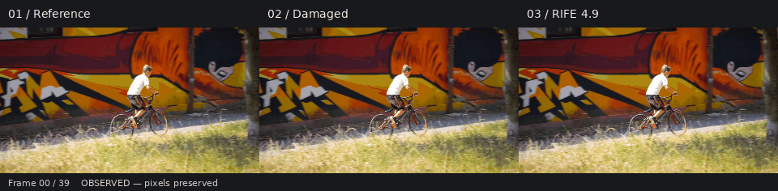
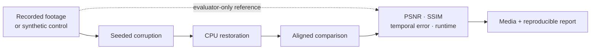
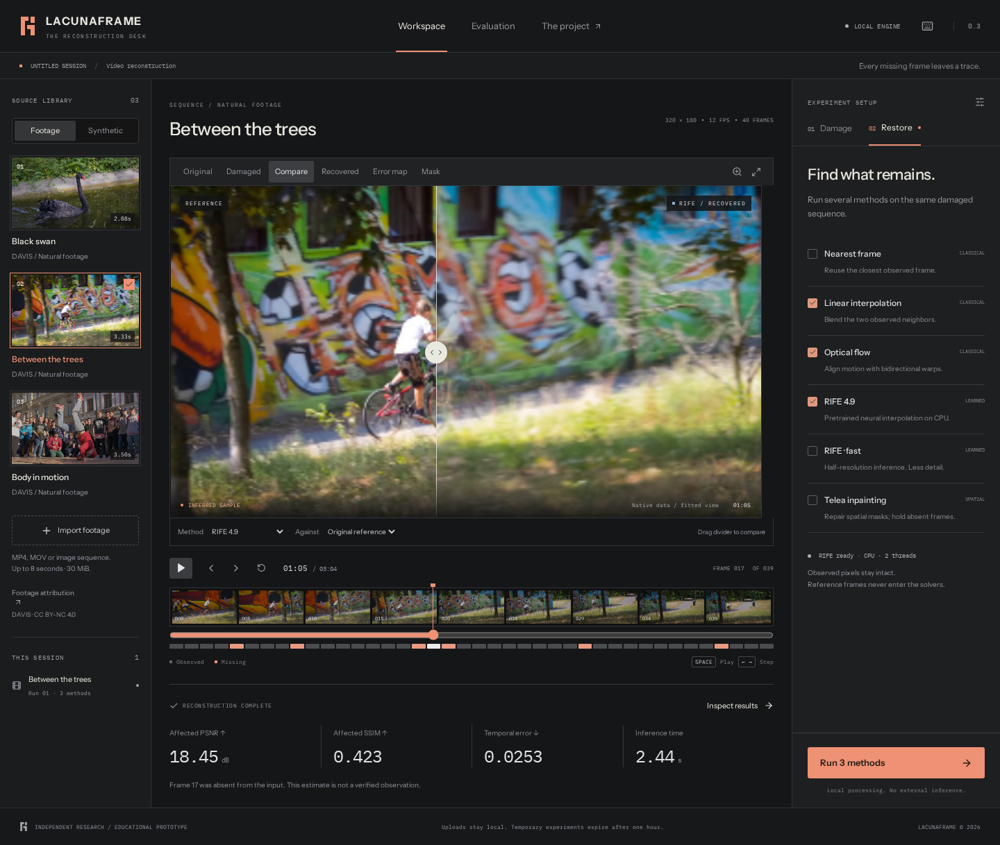
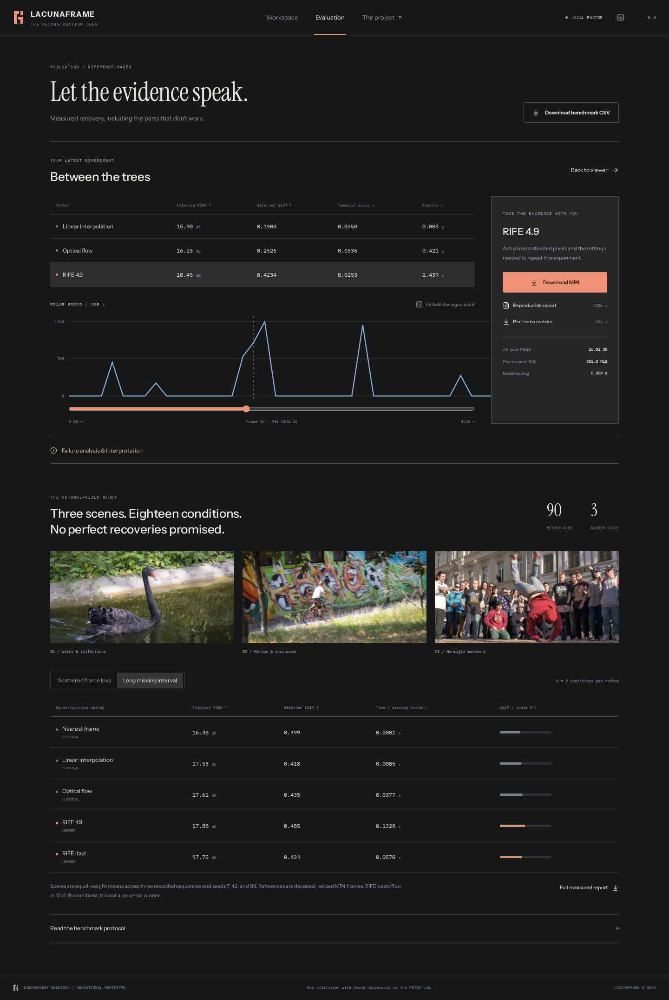
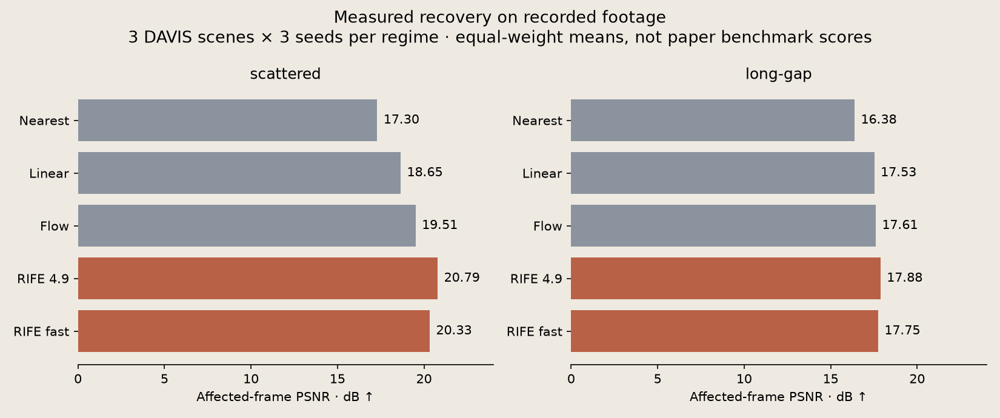

<div align="center">

**L A C U N A F R A M E**

# Every missing frame leaves a trace.

A local video-corruption and recovery workbench.<br/>
Real footage. Actual pixel restoration. Evidence you can inspect.

[Start the guided tour](docs/README.md) · [Run the app](docs/guides/QUICKSTART.md) · [Explore the experiments](examples/README.md) · [Read the results](docs/REPORT.md)



*Recorded DAVIS footage / BMX / seed 42. Coral marks an absent sample.*<br/>
*These are actual aligned arrays, annotated for this guide.*

</div>

## First, make something disappear.

Choose a recorded clip or upload your own. Remove frames, hide an interval, mask an object, add noise or blur. Then ask several methods to reconstruct the same damaged observations.

The original stays untouched. The viewer, timeline, error map, and evaluation report all refer to the same timestamps. Every solver operates on pixels. Every result has settings, provenance, and limitations.



## Take the reconstruction desk.



Source library on the left. Pixels and time in the center. Damage and restoration settings on the right. **Workspace**, **Evaluation**, and **The project** connect making an experiment, examining it, and understanding its purpose.

<details>
<summary><strong>See the evaluation page and mobile layout</strong></summary>



[Mobile workspace](docs/design/06-workspace-mobile.png) · [Project presentation](docs/design/04-project.png) · [Mobile project](docs/design/05-project-mobile.png) · [Design rationale](docs/DESIGN.md)

</details>

## Read it as an experience.

The [documentation map](docs/README.md) offers short routes for builders, researchers, and reviewers. For an interactive tour, open **[docs/experience/index.html](docs/experience/index.html)** locally. It includes a real comparison wipe, switchable measured charts, expandable explanations, command copying, and an experiment trail. It works without the processing backend or an external service.

GitHub displays HTML source. To view the rendered guide after cloning:

```bash
python -m http.server 8080 --directory . --bind 127.0.0.1
# Open http://localhost:8080/docs/experience/
```

## Run your first experiment.

Python **3.12** and Node **20.19+**. From the repository root:

```bash
python -m venv .venv
.venv/bin/pip install -r backend/requirements-lock.txt
npm ci
.venv/bin/python scripts/fetch_assets.py
.venv/bin/python -m uvicorn backend.app:app --host 127.0.0.1 --port 8000
```

In a second terminal:

```bash
npm run dev -- --port 5173
```

Open **http://localhost:5173**. Choose **Between the trees**, create damage, run Linear / Optical flow / RIFE, scrub an absent frame, then open Evaluation. Space plays, arrows step, and Home rewinds outside form controls.

Pinned source clips and checkpoints are included. Asset setup verifies checksums and fetches only missing or corrupt files. No API keys, GPU, inference service, or automatic runtime downloads. [Setup, uploads, troubleshooting and Docker →](docs/guides/QUICKSTART.md)

## Let the measurements speak.



Three natural sequences × two corruption regimes × three seeds = **18 conditions**, **90 method runs**. RIFE 4.9 exceeds our classical optical-flow baseline in affected PSNR in **12/18** conditions. Its mean advantage is **1.28 dB** for scattered loss and **0.28 dB** for long intervals.

A second, matched **36-run checkpoint experiment** finds RIFE 4.26 faster, but lower in affected PSNR in **16/18** conditions. We retained that negative result and kept 4.9 as the default. The comparison uses 4.9 ensemble versus 4.26 FP32 exports, so it does not isolate architecture version.

[All study files](examples/README.md) · [Measured report](docs/REPORT.md) · [Natural-study CSV](examples/natural-v02/summary.csv) · [Checkpoint CSV](examples/checkpoint-v03/summary.csv)

<details>
<summary><strong>Look at a failure, not just a headline.</strong></summary>


This is the highest-error missing RIFE frame in the documented BMX long-gap experiment. The figure uses actual arrays, not a reconstructed video thumbnail. Large motion, new visibility, and long gaps remain difficult. [How this figure was made](scripts/build_documentation.py).

</details>

## What actually runs?

| Method | Pixel operation | Use it for |
|---|---|---|
| Nearest frame | Reuse the closest surviving temporal observation | A transparent low-compute baseline |
| Linear | Time-weighted blend of bracketing observations | A simple temporal baseline |
| Optical flow | Dense bidirectional Farnebäck flow, inverse warps, consistency rejection | Motion-compensated interpolation |
| RIFE 4.9 | Pinned pretrained intermediate-flow neural synthesis on ONNX CPU | Learned missing-frame interpolation |
| RIFE fast | Half-resolution inference with the same weights, then upsample | A measured compute/detail tradeoff |
| Telea | OpenCV spatial inpainting; nearest hold for absent frames | Masked regions within observed frames |

RIFE 4.26 is an optional research adapter with a separate comparison script. No denoising or deblurring solver is included; noise and blur are stress tests. No training, distillation, pruning, or diffusion restoration is claimed. [Conventions and assumptions →](docs/RESEARCH.md)

## Find your way through the repository.

```text
src/                 React application: components, typed state and API client
backend/             FastAPI, pixel algorithms, learned adapters and pytest tests
scripts/             Asset setup, benchmarks, documentation and artifact verification
assets/              Pinned clips, two checkpoints, manifests and third-party licenses
examples/            Complete measured studies, controls, arrays, reports and media
public/              Bundled frontend previews and copies of measured summaries
docs/               Guided documentation, figures, interactive tour and QA evidence
tests/              Browser flow and accessibility tests
.github/            Ownership and inactive verification workflow template
```

[Architecture](docs/guides/ARCHITECTURE.md) · [Repository map](docs/guides/REPOSITORY.md) · [Experiment protocol](docs/guides/EXPERIMENTS.md) · [Contributing](CONTRIBUTING.md) · [Changelog](CHANGELOG.md)

## Check the evidence yourself.

```bash
.venv/bin/python -m pytest -q
npm run build
npm run lint
npm run typecheck
npx playwright install chromium
npm run test:browser
.venv/bin/python scripts/verify_artifacts.py
.venv/bin/python scripts/check_documentation.py
```

The current release passed **17 pytest tests**, **5 browser tests**, build, lint and strict TypeScript. Artifact verification checked **120 decoded experiment MP4s** and **36 aligned natural/checkpoint condition reports**. New documentation has its own browser and link checks; see [verification evidence](docs/verification/README.md) for current outputs.

## Research scope and rights.

This is an independent educational/research portfolio, with research context from Korea University PRISM Lab. We reviewed related work including AVIS, InverseCrafter, EPS, InvFusion, BiM-VFI, controllable tracking-based VFI, FILM, and RIFE. [Primary-source comparison and what remains untested →](docs/RELATED_WORK.md)

Three natural scenes do not establish generalization or superiority to those publications. Model training overlap with DAVIS is unknown. The contribution is an inspectable workbench and reproducible comparison infrastructure; algorithmic novelty has not been demonstrated.

**Our code and synthetic controls: MIT.** RIFE retains upstream MIT attribution. **DAVIS footage and derived media: CC BY-NC 4.0**, per the pinned mirror. Local fonts retain SIL Open Font License notices. [Asset sources, changes and licenses](assets/THIRD_PARTY.md).

Uploads stay on the local backend; temporary experiments expire after one hour. MP4/MOV decoding depends on available codecs, with image sequences and GIF export as fallbacks. This is a single-user local app. Docker image build passed; runtime smoke verification hit the workspace disk cap. No hosted deployment is included. The verification workflow is stored as an inactive template outside `.github/workflows`, so pushing cannot start a hosted runner. The publishing script verifies private visibility and rejects active workflows. See [publication status](docs/PUBLICATION.md).

**Project author and maintainer:** [Harishik Dev Singh Jamwal](https://github.com/Harishik).
