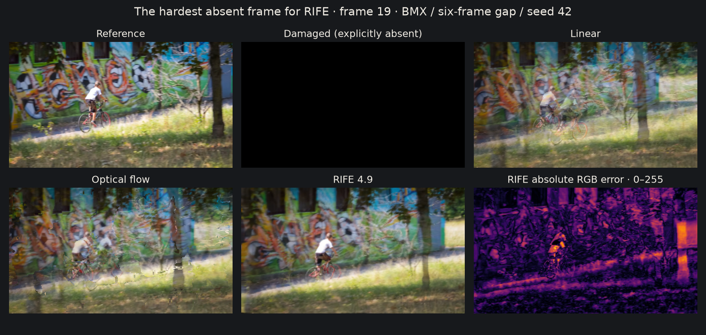
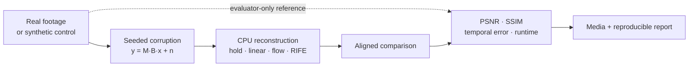

<div align="center">

**L A C U N A F R A M E**

# Every missing frame leaves a trace.

A reproducible workbench for **missing-frame video recovery**. Remove frames from real footage, reconstruct them with classical and neural methods on a CPU, and measure exactly where each method fails.

[Run it](docs/guides/QUICKSTART.md) · [Results](docs/REPORT.md) · [Research direction](research/README.md) · [Guided tour](docs/README.md)


*Real DAVIS footage (BMX, seed 42). Coral marks an absent frame. Every pixel shown is an actual aligned array.*

</div>

## Highlights

- **Five reconstructors, one sealed protocol.** Nearest-frame hold, linear blending, bidirectional Farnebäck flow with consistency rejection, RIFE 4.9, and half-resolution RIFE all get identical damaged observations. The clean reference is visible only to the evaluator, never to a solver.
- **Measured, not asserted.** 18 natural-video conditions (3 scenes × 2 loss regimes × 3 seeds) and 90 method runs. Every score is recomputable from saved arrays: 120 MP4s and 36 condition reports pass automated verification.
- **Neural interpolation on a plain CPU.** Pinned RIFE ONNX checkpoints run through ONNX Runtime. No GPU, API key or network access is needed at runtime.
- **Reproducible across machines.** All video decoding goes through one pinned FFmpeg path, so reference frames are bit-identical on Linux and macOS ([why that mattered](research/results/portability/README.md)).
- **Negative results kept.** A newer checkpoint that loses 16/18 conditions, INT8 builds that don't get faster, and the worst failure frame are all published alongside the wins.

## Results


| Regime | Hold | Linear | Optical flow | **RIFE 4.9** | RIFE fast |
|---|---:|---:|---:|---:|---:|
| Scattered loss, affected PSNR (dB) | 17.30 | 18.65 | 19.51 | **20.79** | 20.33 |
| Long gap (6 frames), affected PSNR (dB) | 16.38 | 17.53 | 17.61 | **17.88** | 17.75 |
| Seconds per missing frame (CPU, 2 threads) | 0.0005 | 0.001 | 0.038 | 0.14 | 0.057 |

RIFE beats classical flow in **12/18** conditions: by +1.28 dB on scattered loss but only +0.28 dB on long gaps. Long missing runs remain the open problem, and that is what the [research track](research/README.md) targets.

<details>
<summary><strong>The worst case, not the best one</strong></summary>



This is the highest-error missing frame in the BMX long-gap run, shown across all methods with a fixed-scale error map. Large motion, newly visible content and long gaps break every method tested.

</details>

[Full report](docs/REPORT.md) · [Natural-study CSV](examples/natural-v02/summary.csv) · [Checkpoint study](examples/checkpoint-v03/README.md) · [All experiments](examples/README.md)

## The workbench


Choose a clip or upload your own (MP4/MOV, or a PNG/JPEG sequence). Drop frames, hide an interval, mask a region, add noise or blur. Then run several reconstructors on the same damaged observations and scrub any frame side by side. The **Evaluation** view shows per-frame PSNR/SSIM, temporal error, runtime and a downloadable report. Space plays, arrow keys step.

<details>
<summary><strong>Evaluation page and mobile layout</strong></summary>


[Mobile workspace](docs/design/06-workspace-mobile.png) · [Project page](docs/design/04-project.png) · [Design rationale](docs/DESIGN.md)

</details>

## Quick start

Python 3.12 and Node 20.19+:

```bash
python -m venv .venv
.venv/bin/pip install -r backend/requirements-lock.txt      # Intel macOS: requirements-lock-macos-x86_64.txt
npm ci
.venv/bin/python scripts/fetch_assets.py                     # verifies checksums, fetches only missing files
.venv/bin/python -m uvicorn backend.app:app --host 127.0.0.1 --port 8000
```

In a second terminal, run `npm run dev -- --port 5173`, then open http://localhost:5173. Docker, uploads and troubleshooting: [Quick start guide](docs/guides/QUICKSTART.md).

## How it works



| Method | What it does |
|---|---|
| Nearest frame | Reuses the closest surviving frame |
| Linear | Time-weighted blend of the frames on either side of the gap |
| Optical flow | Dense bidirectional Farnebäck flow, inverse warping, forward/backward consistency rejection |
| RIFE 4.9 | Pretrained intermediate-flow network (ONNX, CPU) at the exact missing timestamp |
| RIFE fast | Same weights at half resolution, then upsampled: about 2.4× faster |
| Telea | Spatial inpainting for masked regions within surviving frames |

Outside models can be scored on identical pixels through a sealed exchange format (`inputs.npz` for the solver, `targets.npz` for the evaluator only): see [Experiments](docs/guides/EXPERIMENTS.md#4-compare-an-outside-model-on-identical-pixels). Details: [Architecture](docs/guides/ARCHITECTURE.md) · [Conventions](docs/RESEARCH.md).

## Research direction

The next phase asks a question existing interpolation work doesn't answer: **given only the surviving frames, how much of a missing interval can be recovered, and where will the reconstruction be wrong?** The plan has three parts:

- a realistic missing-frame benchmark (burst and codec loss, gaps of 1–32 frames);
- a recoverability estimate computed from the observations alone;
- reconstruction with statistically calibrated, distribution-free risk maps.

[Prior-art audit and novelty check](research/literature/RECOVERABILITY_PRIOR_ART.md) · [CPU compression pilot](research/results/compression-pilot/README.md) · [Research program](research/RESEARCH_PROGRAM.md)

## Verify everything

```bash
.venv/bin/python -m pytest -q backend/tests research/tests   # 25 tests
.venv/bin/python scripts/verify_artifacts.py                 # 120 MP4s, 36 reports, checksums
npm run build && npm run lint && npm run typecheck
npx playwright install chromium && npm run test:browser
```

Captured outputs: [verification evidence](docs/verification/README.md).

## Limitations

Three DAVIS scenes at 320×180, with already-compressed MP4 references, are a diagnostic set. They don't establish generalization, and RIFE's training overlap with DAVIS is unknown. No model has been trained or fine-tuned here. Noise and blur are stress tests with no dedicated solver. This is a single-user local app with no hosted deployment yet. Comparisons with published methods require the matched protocol described in [Related work](docs/RELATED_WORK.md).

## Repository

```text
src/        React + TypeScript workbench
backend/    FastAPI, decoding, pixel algorithms, ONNX adapters, pytest
research/   Research track: protocols, runners, literature audit, results
scripts/    Asset setup, benchmarks, documentation, artifact verification
examples/   Complete measured studies (arrays, reports, media)
docs/       Guides, report, figures, interactive tour, QA evidence
```

[Repository map](docs/guides/REPOSITORY.md) · [Contributing](CONTRIBUTING.md) · [Changelog](CHANGELOG.md) · [Cite this work](CITATION.cff)

## License and credits

Code and synthetic controls are **MIT**. RIFE weights keep their upstream MIT attribution. **DAVIS footage and derived media are CC BY-NC 4.0** (non-commercial). Fonts are under the SIL OFL. See [asset sources and licenses](assets/THIRD_PARTY.md).

Research context: Korea University PRISM Lab (inverse problems and generative priors). This is independent work with no lab affiliation.

**Author and maintainer:** [Harishik Dev Singh Jamwal](https://github.com/Harishik)
