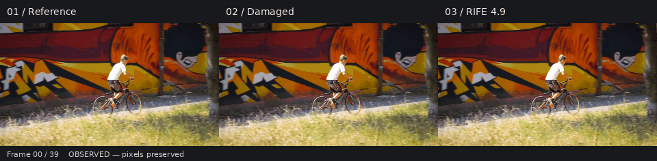
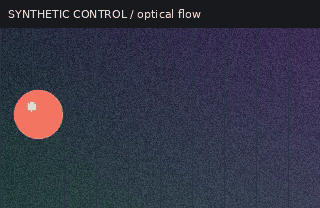

# A field guide to missing time

**Start with the footage. Follow the evidence. Open the code when curiosity takes you there.**

> Recorded DAVIS footage, not a generated scene. Reference / damaged / RIFE, at the same timestamps. The animated images below respect reduced-motion preferences in the interactive guide; GitHub's GIF display depends on your browser settings.

## Choose your route

| You have… | Follow this route | You will leave with… |
|---|---|---|
| 3 minutes | [Interactive field guide](experience/index.html) → [results](REPORT.md) | A visible experiment, its measured outcome, and its limits |
| 10 minutes | [Quickstart](guides/QUICKSTART.md) → [experiment walkthrough](guides/WALKTHROUGH.md) | Your own damaged clip, comparison and exported record |
| A research question | [Protocol](guides/EXPERIMENTS.md) → [related work](RELATED_WORK.md) → [raw archive](../examples/README.md) | Reproducible conditions and an honest comparison contract |
| A code review | [Architecture](guides/ARCHITECTURE.md) → [repository map](guides/REPOSITORY.md) → [QA evidence](verification/README.md) | The pixel path, important boundaries, and executed checks |

**To render the interactive guide:** from the repository root, run `python -m http.server 8080 --directory . --bind 127.0.0.1` and open **http://localhost:8080/docs/experience/**. It also opens directly as a local file. GitHub's file viewer displays HTML source. The guide embeds measured chart data and makes no external requests.

## The chapters

1. **[Observe → remove → reconstruct → question](guides/WALKTHROUGH.md).** The controls, timestamps and interpretations behind one real experiment.
2. **[How a missing frame is estimated](RESEARCH.md).** Inverse problems, flow conventions, model inputs and unavoidable ambiguities.
3. **[What actually happened](REPORT.md).** Natural results, CPU profiling, checkpoint regressions and verification limits.
4. **[Where this sits in research](RELATED_WORK.md).** Recent primary sources and capabilities we have—and have not—implemented.
5. **[Repeat the experiment](guides/EXPERIMENTS.md).** Exact commands, artifact layouts, metrics and external-model exchange.
6. **[Read the instrument](guides/ARCHITECTURE.md).** Application state, backend storage, algorithm boundaries and export behavior.
7. **[Why it looks this way](DESIGN.md).** Workspace hierarchy, typography, color roles and responsive behavior.

## Open the evidence drawer

| Evidence | Where to look |
|---|---|
| Animated reference / corruption / recovery | [Actual pixel GIF](visuals/recovery-loop.gif) |
| Same worst frame for all methods | [Failure contact sheet](visuals/failure-contact-sheet.png) |
| Errors and missing timestamps | [Time-indexed plot](visuals/error-timeline.png) |
| Natural study | [PSNR figure](visuals/natural-results.png), [all files](../examples/natural-v02/README.md) |
| Newer checkpoint experiment | [Quality/runtime plot](../examples/checkpoint-v03/quality-runtime.png), [all files](../examples/checkpoint-v03/README.md) |
| Real interface captures | [Workspace](design/02-reconstruction.png), [evaluation](design/03-evaluation.png), [case study](design/04-project.png), [mobile](design/06-workspace-mobile.png) |
| Executed verification | [Logs and audit JSON](verification/README.md) |
| Original and third-party rights | [MIT code](../LICENSE), [asset provenance](../assets/THIRD_PARTY.md) |

What about the earlier synthetic work?

Nothing has been discarded. [Synthetic v0.1](../examples/synthetic-v01/README.md) preserves all three diagnostic scenarios, reports, plots and videos. [Interface history](../examples/interface-history/README.md) preserves previous screenshots. [The historical report](REPORT_SYNTHETIC_V01.md) is clearly marked as earlier evidence.

[Publication status](PUBLICATION.md) · [Back to the project](../README.md) · [Full operations reference](RUNBOOK.md) · [Change history](../CHANGELOG.md)
