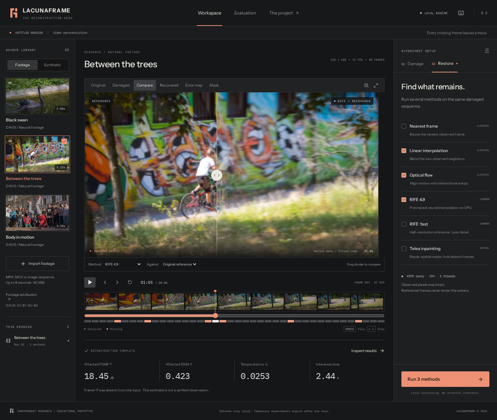

# LACUNAFRAME · v0.3

**Every missing frame leaves a trace.** A local video-corruption and recovery lab with **real natural footage and pretrained RIFE running on CPU**, plus classical baselines. Independent educational research software, not affiliated with Korea University PRISM Lab.



[Project presentation](design/04-project.png) · [Mobile workspace](design/06-workspace-mobile.png) · [Research comparisons](RELATED_WORK.md) · [Measured report](REPORT.md)

## Run

Python 3.12 and Node 20.19+ (verified on Python 3.12 / Node 24):

```bash
cd /workspace/lacunaframe
python -m venv .venv
.venv/bin/pip install -r backend/requirements-lock.txt
npm ci
.venv/bin/python scripts/fetch_assets.py
.venv/bin/uvicorn backend.app:app --host 127.0.0.1 --port 8000
```

Second terminal:

```bash
cd /workspace/lacunaframe
npm run dev -- --port 5173
```

Open **http://localhost:5173**. The pinned weights and three source clips are already present in this workspace; asset setup verifies them and downloads only missing/corrupt copies. Downloads are public and free; no keys or paid service. During inference, nothing leaves the backend and no model downloads occur. Vite proxies `/api` to port 8000.

Choose natural footage or upload → preview seeded corruption → choose methods → reconstruct → compare with the reference or damaged input → inspect per-method metrics/error maps → download actual video and JSON/CSV. Space plays, arrows step outside input controls. The default model selection includes RIFE. Synthetic scenes remain available as diagnostic controls, not the primary demonstration or evidence of natural-video performance.

## v0.3: the reconstruction desk

A cohesive three-part interface: a footage-first workspace with synchronized wipe/timeline and damage/restore inspector; an evaluation page with actual per-method scores, frame-selectable error graph and exports; and an editorial case study with real output media, evidence, sources and limitations. The React application is split into typed components and a workbench state hook. Desktop/mobile layouts, keyboard interactions, offline states, and WCAG A/AA automated accessibility checks are exercised in Playwright. Fonts and assets are bundled locally. [Design decisions](DESIGN.md).

An additional **RIFE 4.26 CPU experiment** compares two checkpoints across the identical 18 conditions, producing 36 measured runs. The newer candidate is faster but loses affected PSNR in 16/18 conditions; 4.9 stays the default. This is a comparison of deployable exports (4.9 ensemble versus 4.26), not a controlled architecture ablation. The optional research adapter is outside the UI. [Full comparison](RELATED_WORK.md#the-newer-checkpoint-experiment).

The lossless [external comparison contract](RELATED_WORK.md#how-to-make-a-valid-outside-comparison) exports observations separately from evaluator-only targets and rejects frame/timestamp mismatches. It makes matched comparisons executable; it does not claim that untested papers were beaten.

## What changed from v0.1

- Three **natural DAVIS sequences**: black swan with water reflections; BMX cyclist with camera motion/occlusion; breakdance with fast nonrigid motion. Real recorded frames, not generated shapes or pans over still photographs.
- **RIFE 4.9, FP32 ONNX**, pinned by revision and SHA-256, forced to CPUExecutionProvider, sequential execution, graph optimizations, two intra-op threads. No PyTorch, CUDA, GPU or inference service needed.
- **RIFE Fast**: the same pretrained weights at half spatial resolution, then bilinear upsampling. Faster with visibly reduced fine detail. This is a spatial compute tradeoff, not distillation, pruning, or newly trained weights.
- **18 natural-video experiments / 90 method runs**: three scenes × two gap regimes × three seeds. Full per-frame reports, CSVs, original source files, damaged/recovered clips, error curves and worst-frame comparison sheets.
- Actual CPU profiling across graph optimization and thread counts, separate processes per configuration. UI shows model availability, source attribution, a live method-comparison table and the saved natural benchmark.

[Measured results and limitations](REPORT.md) · [Research context and conventions](RESEARCH.md) · [Asset provenance/licenses](../assets/THIRD_PARTY.md) · [Exact hashes and URLs](../assets/manifest.json)

Verified locally: **17 pytest tests**, **4 browser tests**, production build, lint and strict TypeScript. Artifact audit decodes **120 MP4s** and checks **36 condition reports**. [Captured verification output](verification/README.md). Docker image build passed; container runtime smoke testing hit this workspace’s disk cap.

## Algorithms and limits

| Method | Actual operation | Scope |
|---|---|---|
| Nearest frame | Closest observed temporal sample, earlier at ties | Missing frames |
| Linear blend | Time-weighted blend of valid bracketing observations | Missing frames |
| Motion compensated | Farnebäck bidirectional flow, inverse warps, consistency rejection | Missing frames |
| RIFE 4.9 | Pretrained intermediate-flow neural synthesis at requested timestep | Missing frames |
| RIFE Fast | RIFE at half input resolution, then resize | Missing frames, lower detail |
| Telea | OpenCV spatial inpainting; nearest hold for absent frames | Within-frame masks |

All solvers receive only the damaged arrays, missing flags and masks. Observed frames remain untouched by temporal methods. Boundaries fall back explicitly to nearest observations. Long gaps are warned about; pretrained networks can create wrong shapes or positions. No calibrated RIFE confidence is claimed. No diffusion restoration, denoising or deblurring is implemented. Noise and blur are corruption stimuli, not promised repair capabilities. There is no freehand mask editor: the brush option is a procedural stroke.

Missing samples are explicit flags, with zero storage placeholders that are never treated as observed anchors. Playback labels missing samples. Metrics for the damaged clip penalize the zero placeholders; that convention is disclosed in each report. Error maps show mean absolute RGB error through a fixed 0–255 Inferno scale. Frame times are normalized sample indices divided by FPS.

## Natural-video protocol

The three MP4s are a pinned no-overlay mirror of DAVIS footage; their `raw` names **do not mean camera RAW**. References are their decoded, letterboxed RGB frames at 320×180, sampled every second frame from 24fps. The clips contain 25, 40 and 42 samples (2.08–3.50 seconds). We retain their actual lengths; no looping or synthetic extension. Source indices/timestamps, reference hashes and licensing are in metadata.

Before seeing results, we chose seeds **7, 42, 99** and two regimes: 20% Bernoulli missing samples; or 10% missing samples plus a six-frame interval beginning at 40% of the sequence. Every method receives the identical corruption. No model is trained, distilled, fine-tuned or selected against these targets. Checkpoint training overlap with DAVIS is unknown, so this is not a verified unseen-data benchmark. Three clips and repeated seeds are not enough for statistical generalization.

Metrics use reconstructed arrays **before lossy export encoding**:

- PSNR: `10 log10(255² / pooled RGB MSE)`. Exact matches are JSON string `Infinity`, not nonstandard JSON infinity. Undefined affected scores are null.
- SSIM: mean channelwise local SSIM, data range 255, largest odd window ≤7. Null for images below 3 pixels per side. Masked SSIM uses affected centers but neighborhoods can cross mask boundaries.
- Separate all-frame, affected-frame and affected-pixel scores; noise/blur mark the entire support affected. On these temporal-only benchmarks, affected pixels are all pixels in missing frames.
- Temporal error: mean absolute error in consecutive-frame differences relative to the reference, divided by 255. This is not a learned perceptual flicker score.
- Summary tables use **equal-weight mean per-experiment scores** (nine experiments per method/regime), not pooled dataset PSNR. CSV retains every scene/seed result and regressions.
- Runtime excludes evaluation, encoding and model initialization (reported separately). Per-missing-frame runtime includes boundary holds. Live memory numbers are sampled process RSS and include cached models, not exclusive model memory. The CPU profile uses separate subprocesses and reports whole-process high-water RSS.

## Reproduce and test

```bash
.venv/bin/python -m pytest -q
npm run build
npm run lint
npm run typecheck
LACUNA_DATA=/tmp/lacunaframe-natural-benchmark .venv/bin/python -m backend.benchmark_natural
.venv/bin/python scripts/profile_rife.py
# Playwright starts local servers if they are not already running:
npx playwright install chromium
npm run test:browser
```

`examples/natural-v02/` contains the five-method natural-video study. `examples/checkpoint-v03/` contains the 4.9/4.26 comparison; reproduce with `.venv/bin/python scripts/fetch_assets.py --candidate` then `.venv/bin/python scripts/compare_checkpoint.py`. `examples/external-pack-v03/` contains a verified lossless comparison pack and linear prediction/evaluation. `examples/synthetic-v01/scenario-*` and `docs/REPORT_SYNTHETIC_V01.md` preserve the earlier synthetic diagnostics. The natural benchmark deletes only its own temporary jobs after exporting artifacts. Set a separate `LACUNA_DATA` when benchmarking. Timings vary with host load; use the same machine and run configurations sequentially for comparison.

## Uploads, privacy and storage

MP4/MOV support depends on local codecs; PNG/JPEG sequences provide a robust fallback, sorted lexically at 12fps (use padded filenames). MIME, decode, dimensions, duration and count are checked. Limits: combined 30 MiB, source ≤1920×1080, video ≤8 seconds, ≤96 sampled frames, ≤2000 decoded input frames. Output is letterboxed to 320×180 and sampled at up to 12fps. Audio is discarded. Variable-frame-rate uploads use nominal decoder FPS, not exact original presentation timestamps. Their evaluation reference is the normalized decoded input.

Temporary UUID directories under `LACUNA_DATA` (default `/tmp/lacunaframe`) expire after an hour, swept every minute; running jobs are exempt until completion. Built-in source footage is permanent. At most 32 temporary/source directories and one CPU restoration job at a time. Session history lives in browser memory. No arbitrary path API or shell interpolation of upload names. Restart interrupts active jobs. This is a trusted single-user app, not an authenticated public service.

## API / deployment

`GET /api/demos`, `/api/capabilities`, `/api/benchmarks`; `POST /api/upload`, `/api/scenarios`, `/api/run`; `GET /api/results/{id}`, `/api/frames/{id}/{kind}/{index}`, `/api/download/{id}/{filename}`. Interactive schema: http://localhost:8000/docs.

Optional Docker backend (image build verified; runtime smoke test blocked by this workspace’s Docker disk limit):

```bash
docker build -t lacunaframe-backend .
docker run --rm -p 127.0.0.1:8000:8000 --memory=2g --cpus=2 lacunaframe-backend
npm run build
```

If a corporate proxy uses a private certificate authority, pass its trusted bundle using BuildKit: `docker build --secret id=pip_ca,src=/path/to/trusted-ca-bundle.crt -t lacunaframe-backend .`. The optional secret is not stored in the image.

Serve `dist/` with a same-origin `/api/*` reverse proxy to this backend. Keep one uvicorn worker; configure upload/time limits, HTTPS/authentication and resource isolation before public exposure. Vite proxy applies only to development. GitHub Pages alone cannot run reconstruction; a separate backend and appropriate origin/authentication configuration are required. No deployment or push was performed.

**Licenses:** our code and synthetic diagnostics are MIT. RIFE weights retain upstream MIT attribution. Natural DAVIS footage and its derived screenshots/exports retain the mirror's **CC BY-NC 4.0** terms; they are not relicensed MIT. See `assets/THIRD_PARTY.md`.
