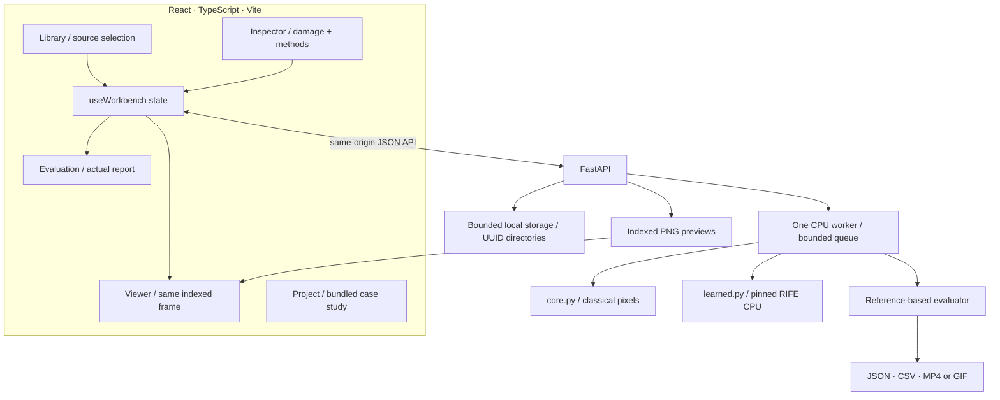

# Follow the pixels

[Documentation map](../README.md) · [Repository map](REPOSITORY.md)



## The frontend owns interaction, not invented results

[`useWorkbench.ts`](../../src/lib/useWorkbench.ts) manages sources, configuration, scenario creation, job polling, method selection, frame index and current-session history. Changing corruption invalidates the old scenario and result. Backend status drives progress. Completed reports drive metrics and downloads.

[`Viewer.tsx`](../../src/components/Viewer.tsx) uses one index for reference, damage, reconstruction, mask and error map. The comparison divider changes clipping, not image content. [`Evaluation.tsx`](../../src/components/Evaluation.tsx) reads the actual per-method report and the separately labeled saved study. [`Project.tsx`](../../src/components/Project.tsx) is an editorial case study with bundled real output media.

The API client only calls same-origin `/api`. Vite proxies development requests to port 8000. The watcher ignores generated evidence and backend paths so a captured log cannot reset an active experiment.

## The backend preserves the experiment boundary

```mermaid
sequenceDiagram
    participant U as Browser
    participant A as FastAPI
    participant C as CPU worker
    U->>A: POST /scenarios (source + seed + severity)
    A->>A: Preserve reference; store damage + missing flags + mask
    A-->>U: Scenario metadata / aligned timeline
    U->>A: POST /run (scenario + methods)
    A-->>U: Job identifier
    A->>C: Damaged pixels, flags and masks only
    loop Job progress
      U->>A: GET /results/{id}
      A-->>U: Real status / progress
    end
    C->>C: Restore → evaluate vs reference → encode
    C-->>A: JSON / CSV / media
    U->>A: GET indexed frames / downloads
    A-->>U: Actual saved output
```

| Boundary | Implementation |
|---|---|
| Input normalization | `backend/app.py`: bounded decoding, letterbox to 320×180, explicit source metadata |
| Controlled damage | `backend/core.py:corrupt`: deterministic RNG, explicit missing flags, spatial masks |
| Restoration | `core.py:restore`: no clean reference argument; observed anchors only |
| Classical motion | Forward/backward flow, inverse destination-to-source remaps, consistency/out-of-bounds rejection |
| Learned inference | `backend/learned.py`: checksum-pinned RIFE 4.9, CPUExecutionProvider, two default threads |
| Candidate research | `backend/candidate.py`: separate 4.26 11-channel vs-mlrt ABI, not selected in the UI |
| Evaluation | `core.py:evaluate`: finite aligned arrays, affected support, correct exact-match/undefined handling |
| Export | `app.py:encode`: H.264 when available, actual GIF fallback otherwise |
| External comparison | `scripts/benchmark_pack.py`: separate observations/targets, exact timestamp and dimension checks |

See [research conventions](../RESEARCH.md) for warp equations, pixel scales and model packing.

## API map

| Endpoint | Purpose |
|---|---|
| `GET /api/demos` | Generated diagnostics and recorded natural sources |
| `GET /api/capabilities` | Verified checkpoint availability and CPU configuration |
| `GET /api/benchmarks` | Saved natural-study summary |
| `POST /api/upload` | Validate and normalize local video or image sequence |
| `POST /api/scenarios` | Apply deterministic corruption |
| `POST /api/run` | Start selected methods on a saved scenario |
| `GET /api/results/{id}` | Poll status or retrieve the full completed report |
| `GET /api/frames/{id}/{kind}/{index}` | Exact indexed PNG preview; error view accepts a method |
| `GET /api/download/{id}/{filename}` | Allowlisted media/report download |

## Storage and execution

Sources and temporary arrays live under `LACUNA_DATA`, default `/tmp/lacunaframe`. Built-in sources remain; UUID uploads/scenarios/runs expire after one hour, swept every minute. Active jobs are exempt during processing. At most 32 source/temp directories and one restoration worker bound the workload. Keep one uvicorn worker: jobs, gate and history are process-local. Restart interrupts jobs; browser history is not durable.

Paths are backend-managed identifiers and allowlisted filenames. Upload names are not interpolated into shell commands. Uploaded media is never sent to a third party. This is a trusted single-user local application, not an authenticated shared service.

## Which copy is authoritative?

- `assets/`: pinned external inputs, hashes and licenses.
- `examples/`: preserved measured experiments and full evidence.
- `public/`: deliberate small copies used by the frontend; artifact verification checks summary equality.
- `docs/visuals/`: regenerated explanation figures from actual arrays and summaries.
- `docs/experience/`: static interactive presentation with embedded measured summary data, no backend dependency.

No static deployment can execute the backend. [Quickstart and deployment boundaries](QUICKSTART.md).
