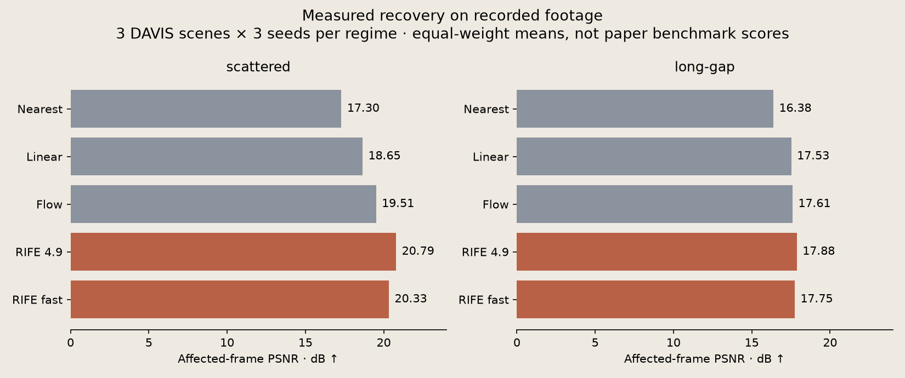
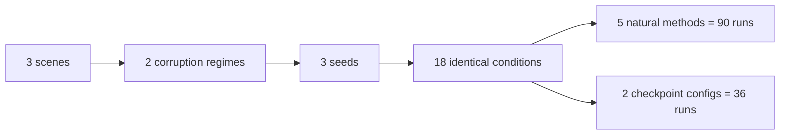

# Reproduce the evidence

[Documentation map](../README.md) · [Archive index](../../examples/README.md) · [Measured conclusions](../REPORT.md)



## The study ledger

| Experiment | Inputs / conditions | Preserved output | Reproduction command |
|---|---|---|---|
| Synthetic v0.1 | 3 deterministic scenes, seed 42, isolated/long-gap/spatial cases | 12 method outputs, reports, curves and same-frame views | `python -m backend.benchmark` |
| Natural v0.2 | 3 DAVIS clips × 2 regimes × seeds 7/42/99 | 90 method runs; 108 damaged/recovered MP4s; per-frame JSON/CSV and selected figures | `python -m backend.benchmark_natural` |
| CPU profile | Same real frame pair; thread/graph settings in separate subprocesses | Warm timing and whole-process high-water memory | `python scripts/profile_rife.py` |
| Checkpoint v0.3 | Identical 18 natural conditions; RIFE 4.9 vs 4.26 | 36 method runs, 18 reports, 12 seed-42 preview MP4s, summaries | `python scripts/compare_checkpoint.py` |
| External exchange | BMX long gap / seed 42 | Lossless observations, separate targets, linear output and scored hashes | `python scripts/benchmark_pack.py …` |
| Documentation case | The same external-exchange arrays | GIFs, contact sheet, error curve and a measured chart payload | `python scripts/build_documentation.py` |

Use `.venv/bin/python` for the `python` commands above. No model training is performed. Reproduction updates the corresponding saved study directory; use a separate checkout/copy if you want to preserve the original run byte-for-byte. Timings are host-dependent.

## 1. Verify the inputs

```bash
.venv/bin/python scripts/fetch_assets.py --candidate
.venv/bin/python scripts/verify_artifacts.py
```

The manifests pin source revisions and SHA-256. DAVIS MP4 mirror references are already lossy; `raw` in the mirror filename means no annotation overlay, not camera RAW. Normalization samples every second 24 fps source frame, letterboxes to 320×180, and retains 25, 40, and 42 samples. Do not treat these as official DAVIS segmentation benchmark scores.

## 2. Repeat the natural and checkpoint studies

Use a separate temporary backend directory for benchmark work:

```bash
LACUNA_DATA=/tmp/lacuna-natural-reproduction .venv/bin/python -m backend.benchmark_natural
.venv/bin/python scripts/profile_rife.py
LACUNA_DATA=/tmp/lacuna-checkpoint-reproduction .venv/bin/python scripts/compare_checkpoint.py
```

Natural regimes are fixed: `scattered` removes each sample with probability 0.2; `long-gap` combines 0.1 removal probability with six consecutive absent samples beginning at 40% of the sequence. Seeds are **7, 42, 99**. Every method gets identical corrupted arrays. Reference frames enter evaluation only. Candidate selection occurred after the original study, so the checkpoint comparison is exploratory rather than a held-out test.



<details>
<summary>Why does the newer checkpoint not become the default?</summary>

4.26 runs correctly on CPU and is approximately 1.6× faster on this host. It loses affected PSNR in 16 of the 18 conditions. The 4.9 export is an ensemble, whereas 4.26 is not; this compares practical configurations and cannot isolate architecture version. The candidate is retained in `backend/candidate.py` and the full archive.

</details>

## 3. Read the metrics correctly

| Metric | Definition / edge behavior |
|---|---|
| PSNR | `10 log10(255² / pooled RGB MSE)` within an experiment. Exact match is string `"Infinity"` in valid JSON. |
| SSIM | Mean channelwise local RGB SSIM; data range 255; largest odd window ≤7. Null when either side is below 3 pixels. |
| Affected pixels | Mask support or all pixels in missing frames; all support for noise/blur. Null if no affected support. |
| Affected frames | Whole frames containing at least one affected pixel. Separate from affected-pixel metrics. |
| Masked SSIM | Uses affected centers; SSIM neighborhoods may cross the mask boundary. |
| Temporal error | Mean absolute error in consecutive-frame differences against reference, divided by 255. Not a learned flicker metric. |
| Summary mean | Equal-weight mean per-condition scores, not pooled dataset PSNR or a confidence interval. |
| Solver runtime | Excludes model loading, evaluation and encoding; includes boundary holds. |
| Memory | Sampled whole-process RSS including caches. Separate profile uses process high-water RSS. |

Metrics precede lossy MP4/GIF export. Do not recompute “the same score” from an encoded preview and expect bit equality. Flow reliability is a consistency heuristic; RIFE has no calibrated confidence.

## 4. Compare an outside model on identical pixels

```bash
.venv/bin/python scripts/benchmark_pack.py export \
  --source natural-bmx-trees --regime long-gap --seed 42 \
  --out /tmp/lacuna-outside-model
```

| File | Who may use it? | Contents |
|---|---|---|
| `inputs.npz` | Restoration process | RGB uint8 NHWC damaged frames; missing flags; spatial masks; exact timestamps and FPS |
| `targets.npz` | Evaluator only | Untouched RGB reference; affected support; exact timestamps and FPS |
| `protocol.json` | Both | Source, corruption configuration, layout and target-access rule |
| `predictions.npz` | Produced by outside model | RGB uint8 NHWC `frames`; exact copied `timestamps` |

```bash
.venv/bin/python scripts/benchmark_pack.py evaluate \
  --targets /tmp/lacuna-outside-model/targets.npz \
  --predictions /tmp/lacuna-outside-model/predictions.npz \
  --method 'method name + exact checkpoint hash' \
  --out /tmp/lacuna-outside-model/result.json
```

The exporter rejects an existing destination; the evaluator opens a new result path exclusively. It rejects shifted timestamps, changed shapes and implicit float rescaling, and hashes targets/predictions. It does not measure external inference time. `examples/external-pack-v03/` preserves a completed linear-baseline smoke path.

A publication comparison also needs matching operators, data splits, color handling, compute, weights, precision and metrics. Our three clips cannot establish superiority to the recent methods in [the research landscape](../RELATED_WORK.md).

## 5. Regenerate the reading experience

```bash
.venv/bin/python scripts/build_documentation.py
.venv/bin/python scripts/check_documentation.py
```

The generator uses the saved lossless BMX pack, executes real linear/flow/RIFE recovery, selects the worst missing RIFE frame, and derives the GIF, contact sheet, error plot and embedded tour data. This is the same configuration as the preserved benchmark. The figures annotate actual arrays; they never invent a score or replace a failed reconstruction with a reference image.
