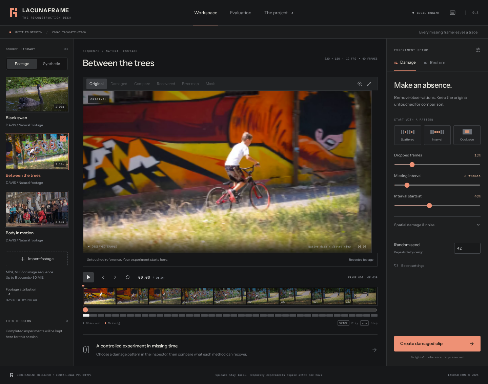

# From clone to first recovery

[Documentation map](../README.md) · Next: [walk through an experiment](WALKTHROUGH.md)

## 1. Prepare the desk

Use Python 3.12 and Node 20.19 or newer. The commands below assume a Unix shell and run from the cloned repository root. On Windows, use `.venv\Scripts\python` and `.venv\Scripts\pip` in place of the Unix virtual-environment paths.

```bash
git clone https://github.com/Harishik/lacunaframe.git
cd lacunaframe
python -m venv .venv
.venv/bin/pip install -r backend/requirements-lock.txt
npm ci
.venv/bin/python scripts/fetch_assets.py
```

The intended repository is private; cloning will require an authorized GitHub login. Publication is currently blocked by the integration’s repository-creation permission; the target clone URL above becomes available after [publication](../PUBLICATION.md). Three source clips and both model exports are included in Git. Setup verifies the default model/source hashes; use `--candidate` to verify or fetch the optional 4.26 candidate too. No Git LFS or model API is required. Downloading replacement assets is an explicit setup action; inference never fetches a model.

## 2. Start the engine and workspace

Terminal A:

```bash
.venv/bin/python -m uvicorn backend.app:app --host 127.0.0.1 --port 8000
```

Terminal B:

```bash
npm run dev -- --port 5173
```

Open **http://localhost:5173**. The same-origin Vite proxy forwards `/api` to port 8000. The API schema is available at **http://localhost:8000/docs**. A real generated diagnostic set and the three recorded clips appear automatically; no media download is needed to begin.



## 3. Try the first route

Choose **Between the trees** → **Interval** → **Create damaged clip** → select **Linear**, **Optical flow**, **RIFE** → **Run**. Scrub an absent sample, compare it with the reference, then open **Evaluation** and download the MP4 and JSON report.

[The guided walkthrough](WALKTHROUGH.md) explains what to inspect and how to interpret it.

## Bring your own footage

- MP4/MOV support depends on the installed decoder. Unsupported files produce an explicit error.
- PNG/JPEG sequences are a robust fallback. Use padded names such as `0001.png`, `0002.png`; frames are sorted lexically at 12 fps.
- Combined upload cap: 30 MiB. Source cap: 1920 × 1080, 8 seconds, 96 sampled frames, 2000 decoded input frames.
- Output is normalized to 320 × 180 at up to 12 fps. Audio is discarded. Variable-frame-rate uploads use nominal decoder FPS, not original presentation timestamps.

All uploads remain on this backend. Temporary UUID experiment folders expire after one hour. Session history lives in browser memory and clears on refresh. Download the report before expiration.

## If something does not start

| Symptom | Check |
|---|---|
| Engine offline | Start uvicorn on port 8000; check its terminal, then Retry connection. |
| RIFE unavailable | Run `scripts/fetch_assets.py`; inspect checksum errors. Classical methods still work. |
| MOV/MP4 decode error | Use a different codec or a PNG/JPEG sequence. Codec support is not assumed. |
| Port already in use | Stop your earlier server or deliberately choose a free port and update the Vite proxy if changing the backend port. |
| Preview expired | Reselect a source and create a new scenario. Existing exported files remain yours. |
| Storage full | Wait for expiry or use a fresh task-specific `LACUNA_DATA` directory. Preserve wanted reports before removing your temporary runs. |
| Private-CA TLS error during Docker setup | Supply your trusted CA bundle through the optional BuildKit secret below; do not disable TLS verification. |

## Optional Docker backend

```bash
docker build -t lacunaframe-backend .
docker run --rm -p 127.0.0.1:8000:8000 --memory=2g --cpus=2 lacunaframe-backend
```

On a network with a private CA:

```bash
docker build --secret id=pip_ca,src=/path/to/trusted-ca-bundle.crt -t lacunaframe-backend .
```

The image build passed locally. Container runtime smoke verification encountered this workspace's disk limit, so runtime verification is incomplete. Native CPU processing is tested. The image runs as a non-root user; use one uvicorn worker.

## Sharing and hosting

This task creates a private source repository; it does not deploy a service. Serve `dist/` with a same-origin `/api` reverse proxy to a separately running backend. Vite's development proxy is not part of a static build. GitHub Pages alone cannot perform reconstruction. A public service would need authentication, resource isolation, HTTPS and upload/time limits beyond the trusted single-user model here.

The publishing script disables GitHub Actions before pushing to avoid automatic runner charges. The retained verification workflow is manual-only; local verification runs without a hosted CI service. No paid service or deployment is needed for the local application or documentation guide.
