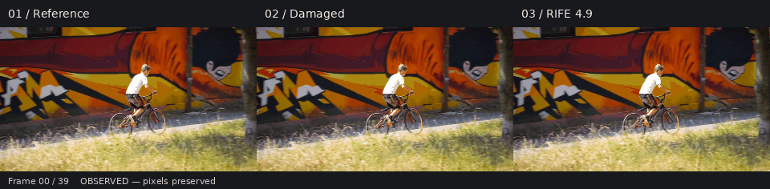
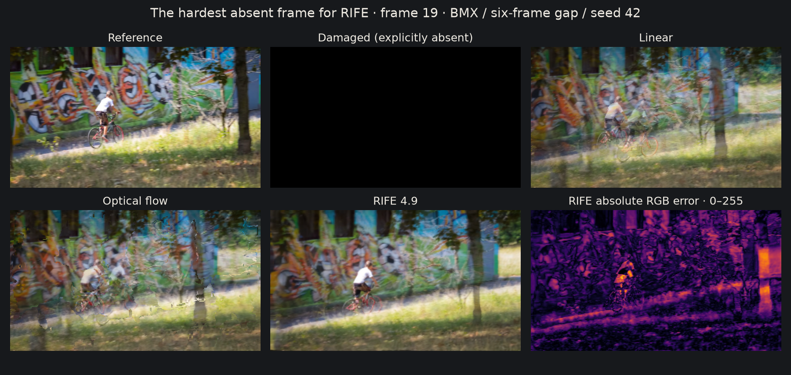
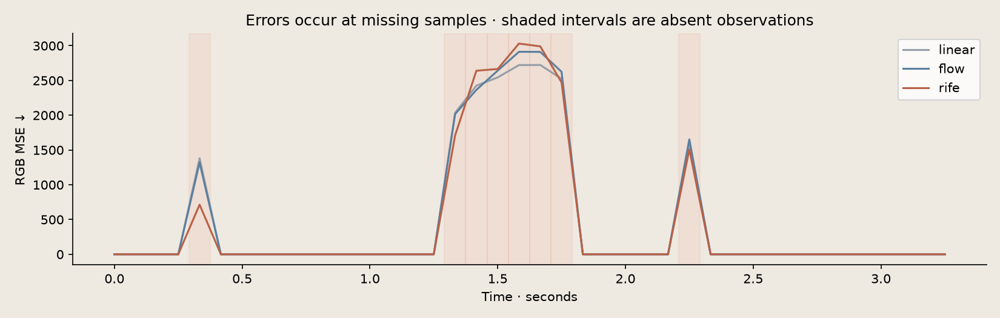

# One absence, all the way through

[Documentation map](../README.md) · [Interactive version](../experience/index.html) · Next: [repeat the study](EXPERIMENTS.md)

## Observe: keep an untouched reference

Choose **Between the trees**, the natural BMX sequence. The source library identifies natural versus synthetic media. This recorded scene contains camera motion, a moving cyclist, textured background, and objects crossing visibility boundaries.

The normalized reference is evaluator-only. It is not passed into a restoration function. The timeline uses sample index divided by normalized FPS; every output has the same count and timestamps.

## Remove: make the experiment repeatable

Choose a damage pattern, note the seed, then **Create damaged clip**. A preset is a convenient configuration, not a benchmark identity. To reproduce the saved long-gap study exactly, use `drop = 0.1`, `gap = 6`, `start = 0.4`, `seed = 42`, spatial mask/noise/blur zero—or use the benchmark command.

Read the damage marks

The availability track marks missing frames separately from observed frames. A missing frame uses a zero storage placeholder, but solvers never use it as an observed anchor. The exported damaged video marks absent samples for playback; evaluation convention separately penalizes the zero placeholder. A genuinely black observed image is valid data.

## Reconstruct: compare the same input

Select **Linear**, **Optical flow**, and **RIFE 4.9** and run them together. The progress display comes from backend stage/progress updates. Runtime is measured; it excludes evaluation and encoding. Loading time and process RSS are reported separately.

Temporal methods preserve observed pixels and fill only absent frames. Boundary gaps lack two anchors and fall back to a disclosed nearest-frame estimate. Telea is a separate spatial inpainting baseline. It does not provide learned temporal content.

## Question: put the estimate beside the truth

Scrub a coral-marked sample. Use **Compare** and drag the divider; the left reference and right recovery must refer to the same frame. Switch methods, compare against damaged input, and inspect **Error map**.

This figure shows the highest-MSE missing RIFE frame for the documented BMX experiment. It makes failure inspectable: motion and visibility can be ambiguous even when a plausible texture is synthesized.

## Measure: follow the error through time

Open **Evaluation**. Select a method row to inspect its scores and downloads. The error chart and its keyboard-accessible slider select a frame index. Including the damaged input changes the plotted scale because absent placeholders can have large errors.

| Readout | Interpretation |
|---|---|
| Affected PSNR / SSIM | Quality where corruption acted; avoids hiding the damage behind intact frames |
| All-pixel PSNR | Whole sequence, including intact frames; often more flattering |
| Temporal error | Difference between recovered and reference consecutive-frame changes, normalized by 255 |
| Runtime | Actual solver time; excludes loading, evaluation, and encoding |
| Process RSS | Sampled whole-process resident memory, including cached models |

## Keep the record

Download the recovered MP4 (or GIF fallback), per-frame CSV, and JSON report. The JSON contains source normalization, corruption settings, missing flags, per-method metrics, model information, warnings and timing. Temporary runs expire after one hour; the session history is an in-memory convenience.

**Try a second question:** increase the gap and repeat the same seed. Does the method's advantage grow or collapse? A negative result is a useful observation—save it alongside the successful run.

[Open all experiment files](../../examples/README.md) · [Metrics and reproduction commands](EXPERIMENTS.md)
