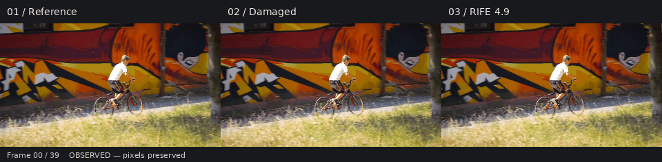

# The experiment archive

[Documentation map](../docs/README.md) · [Protocol](../docs/guides/EXPERIMENTS.md) · [Findings](../docs/REPORT.md)

Every study below contains actual measured results. Earlier work is preserved, including unsuccessful model comparisons and previous interface captures.

| Open an archive | Question | What is retained |
|---|---|---|
| [Natural v0.2](natural-v02/README.md) | How do classical and learned CPU methods handle recorded motion? | 18 conditions, 90 method runs, 108 damaged/recovered MP4s, per-frame reports/CSV, selected figures, CPU profile |
| [Checkpoint v0.3](checkpoint-v03/README.md) | Does a newer RIFE export improve the same conditions? | 36 method runs, 18 reports, 12 preview clips, summary JSON/CSV, quality/runtime plot |
| [External exchange v0.3](external-pack-v03/README.md) | Can an outside method be scored on identical aligned inputs? | Lossless input/target/prediction arrays, protocol and genuine scored hashes |
| [Synthetic v0.1](synthetic-v01/README.md) | Do basic temporal/spatial conventions work under controlled motion? | Three full diagnostic scenarios, 12 method outputs, reports, per-frame CSVs, curves and same-frame previews |
| [Interface history](interface-history/README.md) | How did presentation evolve? | Every earlier UI screenshot; latest captures are under `docs/design/` |

`natural-benchmark.log` preserves the original benchmark console log. Current tests and artifact checks live under [verification](../docs/verification/README.md). Portable experiment files do not depend on temporary backend run IDs continuing to exist.

**Rights:** natural footage and derived media retain CC BY-NC 4.0 terms. Code and original synthetic scenes are MIT. [Sources and licenses](../assets/THIRD_PARTY.md).
