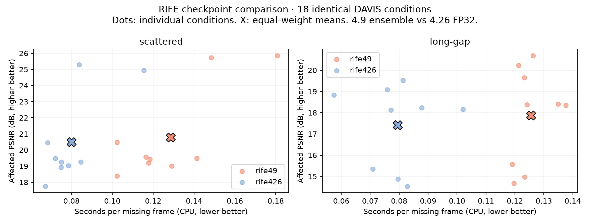

# Matched checkpoint comparison / v0.3

[Archive map](../README.md) · [Protocol](../../docs/guides/EXPERIMENTS.md) · [Measured report](../../docs/REPORT.md)

The identical 18 conditions, with RIFE 4.9 ensemble and RIFE 4.26 FP32 on CPU. 4.26 is faster but has lower affected PSNR in 16/18 conditions. This compares deployable configurations, not architecture version alone. No training or target tuning was performed.

Each condition retains its full per-frame JSON report. Seed-42 conditions retain actual output videos for both checkpoints.

[Complete CSV](summary.csv) · [Complete JSON](summary.json)

## Open a condition

| Scene | Regime | Seed | Condition files |
|---|---|---:|---|
| blackswan | long-gap | 7 | [Report](natural-blackswan-long-gap-7/report.json) · [All files](natural-blackswan-long-gap-7/) |
| blackswan | long-gap | 42 | [Report](natural-blackswan-long-gap-42/report.json) · [All files](natural-blackswan-long-gap-42/) |
| blackswan | long-gap | 99 | [Report](natural-blackswan-long-gap-99/report.json) · [All files](natural-blackswan-long-gap-99/) |
| blackswan | scattered | 7 | [Report](natural-blackswan-scattered-7/report.json) · [All files](natural-blackswan-scattered-7/) |
| blackswan | scattered | 42 | [Report](natural-blackswan-scattered-42/report.json) · [All files](natural-blackswan-scattered-42/) |
| blackswan | scattered | 99 | [Report](natural-blackswan-scattered-99/report.json) · [All files](natural-blackswan-scattered-99/) |
| bmx-trees | long-gap | 7 | [Report](natural-bmx-trees-long-gap-7/report.json) · [All files](natural-bmx-trees-long-gap-7/) |
| bmx-trees | long-gap | 42 | [Report](natural-bmx-trees-long-gap-42/report.json) · [All files](natural-bmx-trees-long-gap-42/) |
| bmx-trees | long-gap | 99 | [Report](natural-bmx-trees-long-gap-99/report.json) · [All files](natural-bmx-trees-long-gap-99/) |
| bmx-trees | scattered | 7 | [Report](natural-bmx-trees-scattered-7/report.json) · [All files](natural-bmx-trees-scattered-7/) |
| bmx-trees | scattered | 42 | [Report](natural-bmx-trees-scattered-42/report.json) · [All files](natural-bmx-trees-scattered-42/) |
| bmx-trees | scattered | 99 | [Report](natural-bmx-trees-scattered-99/report.json) · [All files](natural-bmx-trees-scattered-99/) |
| breakdance | long-gap | 7 | [Report](natural-breakdance-long-gap-7/report.json) · [All files](natural-breakdance-long-gap-7/) |
| breakdance | long-gap | 42 | [Report](natural-breakdance-long-gap-42/report.json) · [All files](natural-breakdance-long-gap-42/) |
| breakdance | long-gap | 99 | [Report](natural-breakdance-long-gap-99/report.json) · [All files](natural-breakdance-long-gap-99/) |
| breakdance | scattered | 7 | [Report](natural-breakdance-scattered-7/report.json) · [All files](natural-breakdance-scattered-7/) |
| breakdance | scattered | 42 | [Report](natural-breakdance-scattered-42/report.json) · [All files](natural-breakdance-scattered-42/) |
| breakdance | scattered | 99 | [Report](natural-breakdance-scattered-99/report.json) · [All files](natural-breakdance-scattered-99/) |

All values are actual saved measurements. Summary rows are equal-weight means across nine conditions per method/regime. Metrics precede lossy preview encoding. Natural-media inputs and derivatives retain CC BY-NC 4.0; original code remains MIT.
