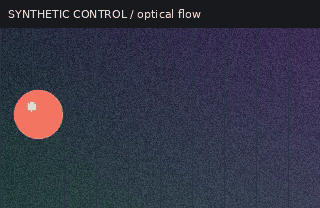

# Synthetic diagnostic controls / v0.1

[Archive map](../README.md) · [Historical measured report](../../docs/REPORT_SYNTHETIC_V01.md)

These are procedurally generated shapes/textures, explicitly synthetic. They exercise controlled motion and algorithm conventions; they are not evidence of natural-video quality. All original experiment files were retained when this folder was organized.

| Condition | Diagnostic emphasis | Files |
|---|---|---|
| [Scenario 1](scenario-1/) | Isolated loss and short interval | Original/damaged/recovered media, report JSON, per-frame CSV, curve and indexed PNGs |
| [Scenario 2](scenario-2/) | Longer missing interval and crossing motion | Same complete evidence |
| [Scenario 3](scenario-3/) | Spatial occlusion with temporal loss | Same complete evidence, including mask and Telea output |

`summary.json` preserves the twelve original method rows. Reproduce with `LACUNA_DATA=/tmp/lacuna-synthetic-reproduction .venv/bin/python -m backend.benchmark` from the repository root. The runner now writes into this named archive folder.

Original synthetic scenes and our code are MIT. These historical values are not substituted into the later natural-study results.
