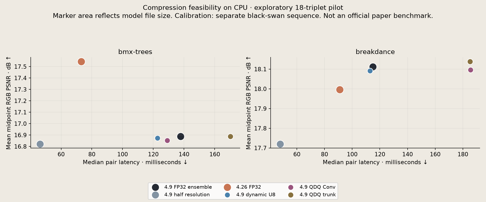

# CPU efficiency research track

Author: **Harishik Dev Singh Jamwal**.

[Local CPU resumption handoff (2026-11-17)](LOCAL_CPU_HANDOFF.md) records the
Intel MacBook hardware inspection, local execution blockers, and next steps.
Read it before rerunning the archived pilot on this laptop.

This branch begins the research program requested after the v0.3 portfolio release. It adds **actual compressed CPU graphs and measurements**, while keeping a clear distinction between a working instrument and a new research result. The requested top-tier research standard has **not yet been achieved**.

| Open | What it contains |
|---|---|
| [Protocol v3 (frozen)](protocols/RECOVERABILITY_V3.md) | Recoverability-guided fusion, label-free calibration, untouched Xiph-B, scene-cut amendment, gate outcomes |
| [Fusion v3 results](results/fusion-v3/xiph-b/README.md) | RGF +0.40 dB over RIFE 4.9 on unseen clips (G5 failed on LPIPS), G5b and G6 passed |
| [Protocol v2 (frozen)](protocols/RECOVERABILITY_V2.md) | Untouched Xiph confirmation set, published baselines, revised G4, amendment 1 (arbitrary-time checkpoints), gate outcomes |
| [Confirmation v2 (Xiph)](results/confirmation-v2/README.md) | G2′ passed (ρ = 0.881 on unseen data), G3′ and G4′ failed under dataset shift; all methods on Xiph |
| [Published baselines on LacunaBench](results/lacunabench-v1-baselines/README.md) | AMT-S, IFRNet-S, IFRNet (midpoint- and arbitrary-time checkpoints) vs v1 methods on the test split |
| [Recoverability v1 (C2/C3)](results/recoverability-v1/README.md) | Observation-only recoverability prediction (G2 passed), conformal risk masks (G3 passed, G4 failed, with diagnosis) |
| [LacunaBench v1 results](results/lacunabench-v1/README.md) | T3 missing runs on 31 SNU-FILM clips: gap curves, loss processes, LPIPS/DISTS, gate G1 (failed) |
| [Data ledger](data/LEDGER.md) | Every external source, pinned revision, selection and bytes against the 6 GB cap |
| [Vimeo90K parity](results/vimeo-parity/README.md) | T1 midpoint sanity check; open 2 dB gap to the published RIFE number, with hypotheses tested |
| [Protocol v1 (frozen)](protocols/RECOVERABILITY_V1.md) | Recoverability pivot: tasks, 6 GB storage cap, splits, metrics, scene-clustered statistics, pre-registered gates G1–G4 |
| [Recoverability prior art](literature/RECOVERABILITY_PRIOR_ART.md) | Full-text novelty audit for C1–C3 and the updated verdict |
| [Scene-level re-analysis](results/reanalysis/README.md) | Archived natural study with the scene as the unit; RIFE vs flow is not supported by three clips |
| [Multi-anchor diagnostic](results/multianchor-diagnostic/README.md) | Quadratic-motion flow vs two-anchor flow on DAVIS + synthetic (diagnostic, not G1) |
| [Portability findings](results/portability/README.md) | Decoder-dependent references (fixed) and runtime-dependent INT8 outputs |
| [Research program](RESEARCH_PROGRAM.md) | Candidate hypothesis, direct novelty collisions, fair comparison contract, concrete evidence gates and outstanding training/evaluation work |
| [Prior-art audit](literature/PRIOR_ART.md) | Relevant lightweight, distillation, quantization, dynamic-compute and diffusion work; review depth and execution status |
| [Measured pilot](results/compression-pilot/README.md) | Six executed CPU configurations, scene-disjoint calibration, per-triplet results and a quality/latency plot |
| [Fixed pilot protocol](protocols/compression-pilot.json) | Case selection, thread budget, timing scope, predeclared continuation criterion and exclusions |
| [Pilot runner](scripts/compression_pilot.py) | Fresh-process execution, actual quantization, saved predictions, hashes, logs and summary |
| [Operator profiler](scripts/profile_operators.py) | Raw ORT traces and explicit scope of operator-duration summaries |
| [Evidence checks](tests/test_compression_evidence.py) | Recomputed scores from saved pixels, calibration/target alignment, actual quantized CPU inference and trace provenance |



Reproduce from the repository root:

```bash
.venv/bin/python research/scripts/compression_pilot.py
.venv/bin/python research/scripts/profile_operators.py
.venv/bin/python research/scripts/summarize_pilot.py
.venv/bin/python -m pytest -q backend/tests research/tests
```

**Verification:** 21 backend/research pytest tests pass, including rescoring all 108 saved prediction triplets and executing all three quantized graphs on CPU. [Captured output](results/compression-pilot/pytest.txt).

The existing virtual environment's lock includes ONNX/ORT. The runners overwrite this exploratory pilot directory; preserve previous trials in a separate copy. No training, distillation, structural pruning, API spending or hosted compute is performed. GPU training is a possible future resource choice; CPU deployment does not require CPU-only training, but any additional paid compute remains unauthorized.

Quantized model binaries inherit RIFE's MIT attribution. Saved DAVIS prediction arrays/figures retain CC BY-NC 4.0. [Asset provenance](../assets/THIRD_PARTY.md) · [Original portfolio documentation](../docs/README.md).
