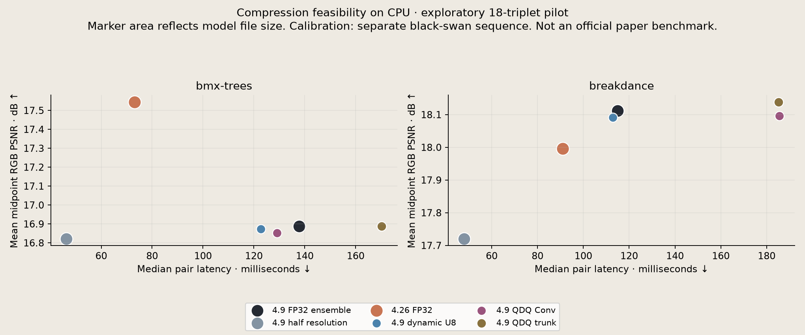

# CPU compression pilot — measured results

This is a feasibility screen, not a new learned method or a publication benchmark. All six variants execute actual inference on CPU. No distillation, fine-tuning or structural pruning has been performed.

| Variant | Scene | RGB PSNR | Δ dB vs FP32 | Median ms | Speed ratio | File MiB | Pilot gate |
|---|---|---:|---:|---:|---:|---:|---|
| 4.9 FP32 ensemble | bmx-trees | 16.888 | +0.000 | 137.78 | 1.00× | 20.46 | fail |
| 4.9 FP32 ensemble | breakdance | 18.112 | +0.000 | 114.90 | 1.00× | 20.46 | fail |
| 4.9 half resolution | bmx-trees | 16.822 | -0.066 | 46.34 | 2.97× | 20.46 | pass |
| 4.9 half resolution | breakdance | 17.720 | -0.392 | 47.89 | 2.40× | 20.46 | fail |
| 4.26 FP32 | bmx-trees | 17.544 | +0.656 | 73.02 | 1.89× | 21.67 | pass |
| 4.26 FP32 | breakdance | 17.997 | -0.116 | 91.05 | 1.26× | 21.67 | pass |
| 4.9 dynamic U8 | bmx-trees | 16.873 | -0.015 | 122.66 | 1.12× | 5.92 | fail |
| 4.9 dynamic U8 | breakdance | 18.092 | -0.021 | 112.85 | 1.02× | 5.92 | fail |
| 4.9 QDQ Conv | bmx-trees | 16.852 | -0.036 | 129.10 | 1.07× | 6.07 | fail |
| 4.9 QDQ Conv | breakdance | 18.096 | -0.017 | 185.47 | 0.62× | 6.07 | fail |
| 4.9 QDQ trunk | bmx-trees | 16.888 | +0.000 | 170.24 | 0.81× | 6.99 | fail |
| 4.9 QDQ trunk | breakdance | 18.139 | +0.026 | 185.14 | 0.62× | 6.99 | fail |

No explicit ORT `quant_pre_process` pass was applied to the already simplified source graph. Improved preprocessing, fusion or export choices may change these results; the pilot does not establish that PTQ is generally ineffective.

A ratio below 1 means slower than the FP32 ensemble baseline. The preset gate requires at least 1.25× speed and no more than 0.2 dB mean loss on **each** evaluation scene. Only the 4.26 configuration passes both scenes in this run. This does not overturn the earlier arbitrary-time long-gap study: the task, case selection and timestep sampling differ. There is no new independent learned-architecture baseline here.

## What was actually changed

- Dynamic U8: ConvInteger activation/weight computation using ORT dynamic quantization; remaining operators stay float.
- QDQ Conv: S8/S8 per-channel static Conv quantization, with activation calibration on black swan only. ConvTranspose, warps and other operators remain float.
- QDQ trunk: quantizes only Conv nodes containing `/convblock/`; leaves input projections and all other operators float.
- Half resolution: uses the unchanged FP32 checkpoint at lower resolution and upsamples. It is **not** a smaller parameter model.
- Neither quantization nor downsampling is a newly trained student or a pruning result.

## Scope and reproduction

Run `.venv/bin/python research/scripts/compression_pilot.py`, then `profile_operators.py` and `summarize_pilot.py` from the repository root. New trials must use `--out <fresh dir>` (or `LACUNA_PILOT_OUT`); the archived directory is protected from overwrites. See [protocol](../../protocols/compression-pilot.json), [full JSON](summary.json), [CSV](summary.csv), [environment](environment.json), and [operator diagnostics](operator-profile.json).

Nine calibration triplets from black swan. Eighteen evaluation triplets from two other scenes; anchor separations 2/4/8 and starts 0/12/24; midpoint only. Same normalized RGB arrays and target timestamps for every method. The source scenes were used in earlier exploratory work, so they are not an untouched research test set. Pretraining overlap is unknown. Two intra-op CPU threads and one inter-op thread; fresh process per variant. Quantizer calibration uses ORT internal CPU defaults.

Unprofiled latency includes input packing, inference, crop, conversion and any resizing. Two warmup calls and three repetitions per triplet; the table is the median across per-triplet medians. These are screening timings, not a robust latency study or significance test. P95 from only three repeats is descriptive interpolation, not a reliable tail-latency estimate. Peak RSS includes Python, imported libraries, normalized data and outputs; it is not isolated model memory.

Quantized ONNX files and construction manifests are in `models/`. They retain upstream RIFE MIT attribution from [the original assets](../../../assets/THIRD_PARTY.md). Prediction arrays and figures derived from DAVIS retain CC BY-NC 4.0. Build/run logs are retained. `attempts/` records two fixed ORT-reader/calibration integration errors; those were implementation errors, not model failures.

The pilot does not measure LPIPS, temporal consistency over complete reconstructed sequences, energy, ARM behavior, native 720p performance or a trained student. These are outstanding research requirements.
